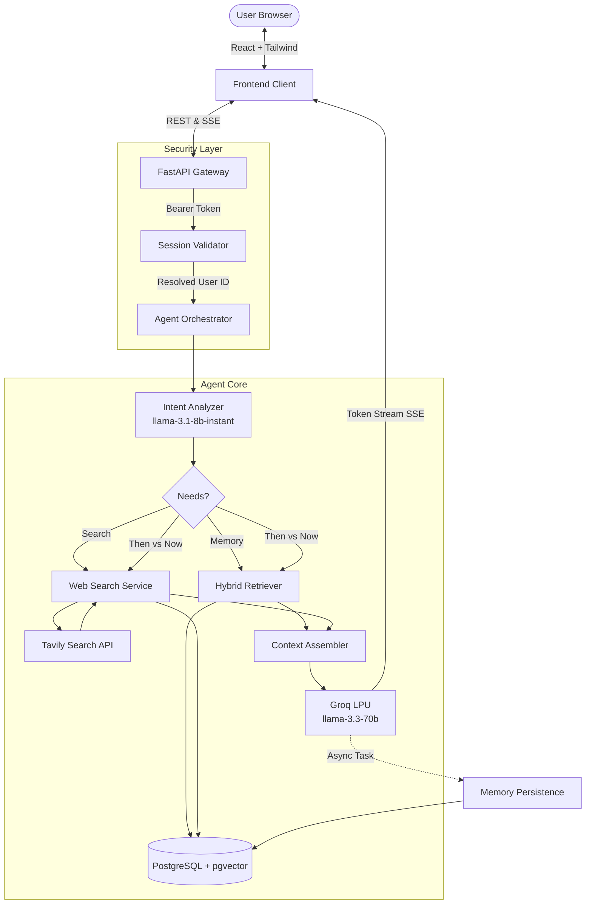
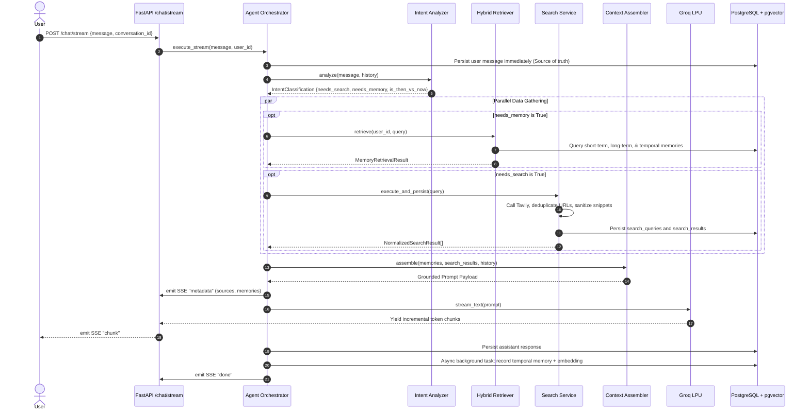
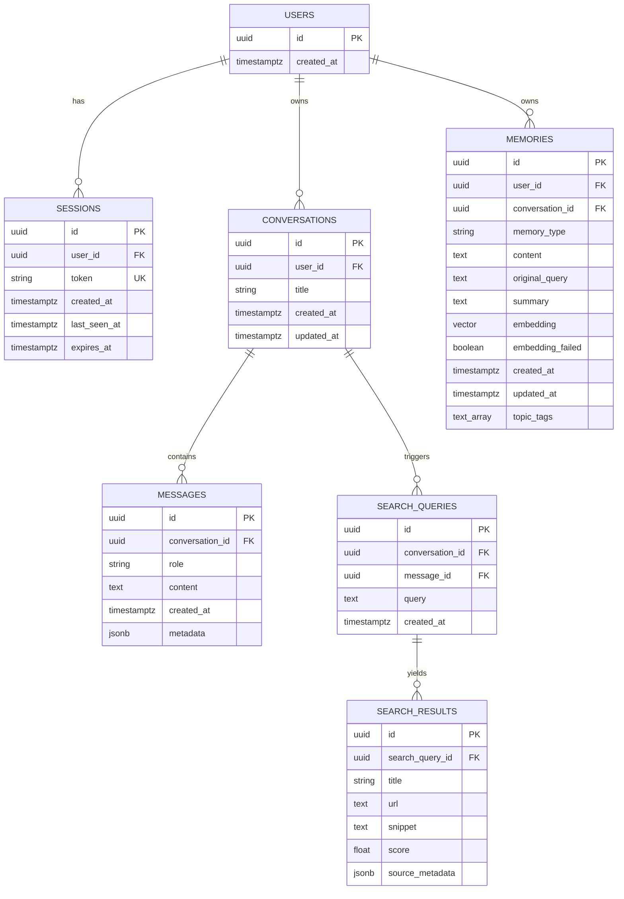

# ECHO — System Architecture and Design Document

> **Product Tagline**: *"It doesn't just remember what you asked. It remembers when, why, and what happened next."*  
> **Challenge**: Minimi Software Engineering Intern Hiring Challenge — Context-Aware Web Intelligence Agent  
> **Repository**: [GitHub Link]

---

## 1. Problem Statement

Most modern chat agents suffer from two fundamental architectural limitations:
1. **Temporal Blindness**: Existing chatbots treat memory either as a raw FIFO sliding window of the last $N$ tokens or as a unindexed summary. When a user asks *"What did I ask yesterday?"* or *"When did we research Spring Boot?"*, traditional systems either hallucinate past conversations or fail entirely because timestamps and original user utterances are discarded.
2. **Context-Disconnected Web Search**: Web search in conventional agents operates in a vacuum. If a user asks *"What are the best backend frameworks?"* on Day 1 and later asks *"Has anything changed since then?"*, standard agents fail to bridge historical findings with real-time web intelligence. They cannot execute comparative "Then vs Now" reasoning.

ECHO solves both problems with a purpose-built system combining **persistent three-tier temporal memory** backed by PostgreSQL + pgvector and **live, grounded web search** powered by Tavily and high-throughput inference on Groq's LPU hardware.

---

## 2. Product Vision

ECHO is a context-aware conversational agent designed to act as an external brain. It provides:
- **Instant Grounded Intelligence**: High-speed live web intelligence using Tavily with strict citation attribution.
- **Accurate Temporal Recall**: Preserves the verbatim user question, exact UTC timestamp, and topic metadata.
- **Then vs Now Comparative Analysis**: Bridges past research with current findings to highlight what evolved over time.
- **Radical Transparency**: A dedicated Context Panel exposing exactly which memories and live sources influenced each answer.

---

## 3. Functional Requirements

| ID | Requirement | Description |
|---|---|---|
| **FR-1** | Single External Tool (Web Search) | The agent interacts externally strictly via Tavily Search API. No external tool proliferation. |
| **FR-2** | Intent Classification | Classifies each query into: Memory Only, Web Search Only, Hybrid, or Then-vs-Now. |
| **FR-3** | Three-Tier Persistent Memory | Stores Short-Term (recent messages), Long-Term (summaries/entities), and Temporal (exact query + UTC timestamp). |
| **FR-4** | Hybrid Memory Retrieval | Ranks memory via $0.6 \times \text{semantic similarity} + 0.4 \times \text{recency decay}$, with date-window filters. |
| **FR-5** | Verified Source Attribution | All web citations must trace directly to persistent `search_results` DB rows. No fabricated URLs. |
| **FR-6** | Then vs Now Diffs | Synthesizes historical findings with fresh search results when asked about changes over time. |
| **FR-7** | Real-Time SSE Streaming | Delivers incremental token streaming and structured metadata via Server-Sent Events. |
| **FR-8** | User Isolation | Enforces strict session token isolation where all queries are filtered server-side by validated `user_id`. |

---

## 4. Non-Functional Requirements

- **Latency**: Time-to-first-token under 1.5 seconds via Groq LPU inference.
- **Grounding & Reliability**: Zero fabricated citations; graceful degradation if web search is unreachable.
- **Fault-Tolerant Persistence**: Memory rows are committed immediately. Embedding generation failure never loses user records.
- **Security**: Server-side session validation; zero client-controlled `user_id` trust; prompt injection sanitization.
- **Testability**: Independent unit and integration tests with mocked external dependencies and in-memory SQLite.

---

## 5. Technology Selection & Justification

| Layer | Technology | Justification |
|---|---|---|
| **Frontend** | React 18, TypeScript, Vite, Tailwind CSS, Lucide React | Blazing fast client, typed safety, modern responsive dark-mode UI with collapsible panels. |
| **Backend** | Python 3.11+, FastAPI, Pydantic v2, SQLAlchemy 2 (Async) | Async non-blocking I/O, native streaming, strict schema validation, robust ecosystem. |
| **LLM Inference** | Groq LPU (`llama-3.3-70b-versatile` & `llama-3.1-8b-instant`) | Exceptional inference speed (500-750 tokens/sec), deterministic JSON mode, and low latency routing. |
| **Search Engine** | Tavily Search API | AI-optimized web search designed specifically for LLM grounding and citation extraction. |
| **Database** | PostgreSQL 16 + pgvector | Single transactional database for relational models, message history, and vector similarity search. |
| **Embeddings** | FastEmbed / Sentence-Transformers (768-dim) | High performance local embeddings matching pgvector dimension without vendor API rate limits. |

---

## 6. High-Level Architecture



---

## 7. Agent Execution Lifecycle

The agent pipeline operates across 8 deterministic stages:



---

## 8. Memory Architecture

ECHO implements a structured **Three-Tier Memory Architecture**:

```
┌────────────────────────────────────────────────────────────────────────┐
│                        ECHO MEMORY SYSTEM                              │
├────────────────────────────────────────────────────────────────────────┤
│ 1. SHORT-TERM MEMORY (Current Session Context)                        │
│    - Sliding window of recent N messages                              │
│    - Maintained in `messages` table with role, content, and latency    │
│    - Preserves immediate dialogue flow and conversational context      │
├────────────────────────────────────────────────────────────────────────┤
│ 2. LONG-TERM MEMORY (Cross-Session Knowledge)                         │
│    - Synthesized summaries of past research topics                     │
│    - Key architecture decisions and entities                          │
│    - Stored in `memories` table (memory_type = 'long_term')            │
├────────────────────────────────────────────────────────────────────────┤
│ 3. TEMPORAL MEMORY (Exact Historical Anchor)                          │
│    - Verbatim user question preserved without modification             │
│    - Exact timezone-aware UTC creation timestamp                      │
│    - Topic tags and conversation identifier associations               │
│    - Enables queries: "What did I ask yesterday?", "When did we..."    │
└────────────────────────────────────────────────────────────────────────┘
```

---

## 9. Hybrid Retrieval Strategy

Memory retrieval combines multiple signals to balance semantic relevance and temporal recency:

### Formula
$$\text{Score}(m) = 0.6 \times \text{CosineSimilarity}(\vec{q}, \vec{m}) + 0.4 \times e^{-\lambda \cdot \Delta t}$$

Where:
- $\Delta t$ is the elapsed time in seconds from creation.
- $\lambda = \frac{\ln(2)}{T_{1/2}}$ with a calibrated half-life $T_{1/2} = 7\text{ days}$.

### Resilient Fallback Mechanics
- If embeddings are unavailable or model generation fails, the system executes an automated fallback to **timestamp range filtering + text search (`ILIKE`)**.
- The `memories` table preserves `embedding_failed=TRUE` to avoid redundant retries and ensure memory writes never fail.

---

## 10. Web Search Architecture & Grounding

1. **Query Generation**: Specialized search query emitted by Intent Analyzer.
2. **Execution & Timeout**: Async call to Tavily Search with configurable timeout (10s).
3. **Normalization & Deduplication**:
   - Strips URL fragments, anchors, and trailing slashes.
   - Filters duplicate domains and identical URLs.
   - Sanitizes text snippets against prompt injection delimiters (`<|im_start|>`, etc.).
4. **Database Persistence**: Search queries and results are stored in `search_queries` and `search_results`.
5. **Strict Grounding**: The LLM prompt is assembled strictly from persisted database rows. The frontend citations trace directly to the database primary keys.
6. **Graceful Degradation**: If Tavily is unreachable, the agent continues in memory-only mode with explicit user notification.

---

## 11. Database Schema



---

## 12. API Contracts

### `POST /api/v1/sessions`
Creates an anonymous session. Returns `session_token` (used as `Authorization: Bearer <token>`).

### `POST /api/v1/chat/stream`
```json
// Request Body
{
  "message": "What frameworks did we discuss yesterday?",
  "conversation_id": "3fa85f64-5717-4562-b3fc-2c963f66afa6"
}
```
**SSE Event Streams:**
- `event: metadata` $\rightarrow$ `{"conversation_id": "...", "sources": [...], "memory_references": [...], "search_used": true}`
- `event: chunk` $\rightarrow$ `{"text": "Yesterday we discussed..."}`
- `event: done` $\rightarrow$ `{"message_id": "...", "latency_ms": 1140}`
- `event: error` $\rightarrow$ `{"code": "SEARCH_UNAVAILABLE", "message": "..."}`

### `GET /api/v1/memory/timeline`
Retrieves chronological memory entries sorted by UTC timestamp with optional `from_date` and `to_date` filters.

---

## 13. Security Considerations

1. **User Isolation**: Frontend never sends `user_id`. The session token resolves the identity server-side via `get_current_user` dependency in FastAPI. Every DB query is scoped to `user_id`.
2. **Untrusted Web Content**: All search snippets are treated as untrusted text. Delimiters such as `<|im_start|>` and system tokens are sanitized before prompt assembly.
3. **No Credential Exposure**: API keys (Groq, Tavily, Postgres) exist strictly on the backend.
4. **CORS Explicit Configuration**: Restricted to allowed origins.

---

## 14. Performance & Latency Optimization

- **Fast Intent Routing**: `llama-3.1-8b-instant` processes routing decisions in ~50-80ms.
- **LPU Token Streaming**: Groq LPU delivers generation speeds exceeding 500 tokens/sec.
- **Async Memory Writes**: Database writes for temporal memory and embedding calculation occur in non-blocking background tasks after stream initialization.
- **Connection Pooling**: SQLAlchemy connection pool (`pool_size=10, max_overflow=20`) with pre-ping validation.

---

## 15. Engineering Trade-offs

| Decision | Choice | Alternative Considered | Justification |
|---|---|---|---|
| **LLM Inference** | Groq LPU | Gemini / OpenAI | Sub-second latency, generous free tier, immune to typical API rate limiting. |
| **Embeddings** | Local ONNX (FastEmbed) | Remote API Embeddings | Zero per-call cost, zero rate limits, resilient CPU execution. |
| **Vector DB** | PostgreSQL pgvector | Pinecone / Qdrant | Single data store, full ACID transactions, zero infrastructure fragmentation. |
| **Auth Model** | Anonymous Session Tokens | Full OAuth / Password Auth | Eliminates demo friction while maintaining 100% user data isolation. |
| **Search Citations** | Database-backed rows | LLM generated URLs | Guarantees zero URL hallucination; citations correspond to verified results. |

---

## 16. Acceptance Criteria Verification

- [x] **Test 1 (Web Search)**: Grounded web search answers questions with verified working URLs.
- [x] **Test 2 (Memory Recall)**: Recalls past conversations accurately without web search when appropriate.
- [x] **Test 3 (Cross-Session Temporal Memory)**: New session can query past questions by date ("What did I ask yesterday?").
- [x] **Test 4 (Then vs Now)**: Compares historical context with fresh search and outputs structured diffs.
- [x] **Test 5 (No Hallucination)**: Explicitly acknowledges when a topic was never discussed.
- [x] **Test 6 (Search Degradation)**: Gracefully handles Tavily timeouts/errors with clear user notices.
- [x] **Test 7 (Streaming Latency)**: Real-time SSE streaming with measured token latency.
- [x] **Test 8 (Documentation & Tests)**: Comprehensive design document, README, and automated pytest suite.
